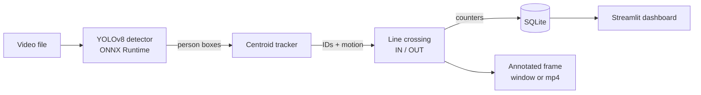

# Smart-Counter: people counter / footfall analytics on the edge

[](https://github.com/bigalex95/Smart-Counter/actions/workflows/ci.yml)
[](LICENSE)
[](https://isocpp.org/)

C++17 pipeline that detects people with YOLOv8 (ONNX Runtime + OpenCV), tracks them with a centroid tracker, counts entries and exits across a virtual line, logs the counts to SQLite and shows them in a Streamlit dashboard. Aimed at small edge boxes that process a video file or stream and need a simple IN / OUT / occupancy number.

<!-- TODO: demo GIF (annotated output video: boxes, IDs, counting line, IN/OUT overlay) -->

## Highlights

- YOLOv8 inference in C++ via ONNX Runtime (CUDA execution provider, CPU fallback) with OpenCV pre/post-processing and NMS.
- Centroid tracker for the `person` class and bi-directional line-crossing counter (IN = downward, OUT = upward, each track counted once).
- Tracker and line-crossing logic are separated from ONNX Runtime and covered by 29 GoogleTest unit tests (tracker, line counter, SQLite logger) that run in CI without a GPU.
- Counter snapshots are stored in SQLite; a Streamlit dashboard reads the same file.
- Docker / Docker Compose files for the detector and the dashboard.

## How it works



The counting line is horizontal and fixed at half of the frame height. More detail in [docs/ARCHITECTURE.md](docs/ARCHITECTURE.md).

## Tech stack

C++17, CMake, OpenCV (unit tests verified with 4.5.4 and 4.10), ONNX Runtime 1.23.2 (GPU package), SQLite3, GoogleTest, Python 3 with Streamlit and pandas (dashboard), Docker Compose, GitHub Actions.

## Getting started

### 1. Model

The ONNX model is not stored in git. Export it with Ultralytics (needs Python and `pip install ultralytics onnx`):

```bash
python -c "from ultralytics import YOLO; YOLO('yolov8s.pt')"   # downloads yolov8s.pt into the current directory
mv yolov8s.pt models/
python python/convert.py                                       # writes models/yolov8s.onnx (opset 12, dynamic, simplified)
```

`python/convert.py --help` lists the options; other YOLOv8 sizes (`yolov8n`, ...) work the same way and are selected with `--input models/yolov8n.pt`.

### 2. Local build and run

Prerequisites: Linux, CMake >= 3.14, a C++17 compiler, OpenCV and SQLite3 development packages (`sudo apt install cmake g++ libopencv-dev libsqlite3-dev`), and the ONNX Runtime GPU package extracted to `third_party/` (the CMake file links the CUDA provider libraries, so CUDA and cuDNN must be installed even if you run with `--cpu`):

```bash
mkdir -p third_party
wget https://github.com/microsoft/onnxruntime/releases/download/v1.23.2/onnxruntime-linux-x64-gpu-1.23.2.tgz
tar -xzf onnxruntime-linux-x64-gpu-1.23.2.tgz -C third_party/

./scripts/build.sh                      # cmake + build into ./build
./build/SmartCounter --model models/yolov8s.onnx --input data/videos/video.mp4 \
                     --output data/output/out.mp4 --db logs/analytics.db --headless
```

Put your own video into `data/videos/` (none is included). Without `--headless` the app opens an OpenCV window (press `q` to quit).

Dashboard:

```bash
pip install streamlit pandas
streamlit run dashboard/app.py -- --db logs/analytics.db
```

### 3. Docker

```bash
cp .env.example .env                                    # optional
docker compose -f docker-compose-gpu.yml up --build     # detector (GPU) + dashboard on http://localhost:8501
```

`docker-compose.yml` runs the detector with `--cpu`. The images expect `third_party/` (ONNX Runtime) and `models/yolov8s.onnx` to exist locally before the build; see [docs/DOCKER.md](docs/DOCKER.md). The Docker setup was not re-run during the latest cleanup.

## Configuration

C++ binary (`./build/SmartCounter --help`):

| Option | Default | Meaning |
| --- | --- | --- |
| `--model <path>` | `models/yolov8s.onnx` | ONNX model |
| `--input <path>` | `data/videos/853889-hd_1920_1080_25fps.mp4` | input video |
| `--output <path>` | `data/output/output.mp4` | annotated video (written in `--headless` mode) |
| `--db <path>` | `logs/analytics.db` | SQLite file |
| `--headless` | off | no window, write the output video |
| `--loop` | off | restart the video when it ends |
| `--cpu` | off | skip the CUDA provider |

Fixed in code for now: confidence threshold 0.5, NMS IoU 0.45, tracker gate 50 px / 5 missed frames, counting line at half of the frame height. Docker variables are in [docs/DOCKER.md](docs/DOCKER.md), Python helper options in [docs/CLI_USAGE.md](docs/CLI_USAGE.md), the SQLite schema in [docs/DATABASE.md](docs/DATABASE.md).

## Tests and CI

The unit tests cover the tracker (ID assignment, persistence, distance gate, disappearance and re-appearance, non-person filtering) and the line counter (IN / OUT, no crossing, exact-line cases, one count per ID) including synthetic tracker + counter walks, plus the SQLite logger (bare file name and nested directory paths). They need OpenCV, SQLite3 and GoogleTest, not ONNX Runtime:

```bash
cmake -S . -B build-tests -DSMARTCOUNTER_BUILD_APP=OFF -DSMARTCOUNTER_BUILD_TESTS=ON
cmake --build build-tests -j
ctest --test-dir build-tests --output-on-failure
```

GitHub Actions ([ci.yml](.github/workflows/ci.yml)) runs exactly these steps on `ubuntu-latest`. CI does not build the full application (no ONNX Runtime there), and there are no Python tests.

## Project structure

```
Smart-Counter/
├── src/            main.cpp, detector.cpp (YOLOv8 + ONNX Runtime), tracker.cpp, line_counter.cpp, database.cpp
├── include/        headers (detection.h, tracker.h and line_counter.h do not depend on ONNX Runtime)
├── tests/          GoogleTest unit tests (tracker, line counter)
├── dashboard/      Streamlit dashboard + Dockerfile
├── python/         convert.py (PyTorch -> ONNX), prototype.py (Python prototype), read_database.py, verify_onnx.py
├── scripts/        build / run / deploy helper scripts (shell)
├── docs/           ARCHITECTURE, DATABASE, DOCKER, CLI_USAGE
├── models/         ONNX model goes here (git-ignored)
├── data/           input videos and output (git-ignored)
├── Dockerfile, docker-compose.yml, docker-compose-gpu.yml, CMakeLists.txt
└── .github/workflows/ci.yml
```

## Status and limitations

- Working prototype. The detector, tracker, counter, database and dashboard exist and the tracker/counter are unit-tested; the full pipeline was not re-run in the latest cleanup.
- No benchmarks yet: earlier FPS claims were removed because no measurements are committed. No accuracy evaluation (counting error vs. ground truth) has been done either.
- The tracker is a simple greedy nearest-centroid matcher: no motion model, no appearance features, no one-to-one assignment (two detections can claim the same track), no handling of occlusion or crowds. ID switches directly cause missed or duplicate counts, so IN - OUT (occupancy) can drift; the overlay and dashboard only clamp the displayed value at 0.
- Frames are resized to the model input without letterboxing (aspect ratio is not preserved).
- The counting line is a fixed horizontal line at half of the frame height; no GUI for placing it. Input is a video file (no camera/RTSP selection in the CLI).
- `docker-compose.yml` always passes `--cpu`, and `HEADLESS_MODE` / `LOOP_VIDEO` cannot be turned off through `.env` (see [docs/DOCKER.md](docs/DOCKER.md)).

Roadmap: replace the centroid tracker with ByteTrack / BoT-SORT, configurable counting zones with GUI line selection, measured benchmarks (CPU and GPU) and a counting-accuracy evaluation on annotated clips, ONNX Runtime TensorRT provider.

## Credits

- [Ultralytics YOLOv8](https://github.com/ultralytics/ultralytics) for the detection model and export tooling. Ultralytics and its pretrained weights are licensed under AGPL-3.0 (or an enterprise license); check those terms before redistributing weights or building a product on them. They are not part of this repository.
- [ONNX Runtime](https://github.com/microsoft/onnxruntime), [OpenCV](https://opencv.org/), [SQLite](https://www.sqlite.org/), [Streamlit](https://streamlit.io/), [GoogleTest](https://github.com/google/googletest).

## License

MIT, see [LICENSE](LICENSE). Copyright (c) 2025 Alibek Erkabayev.
