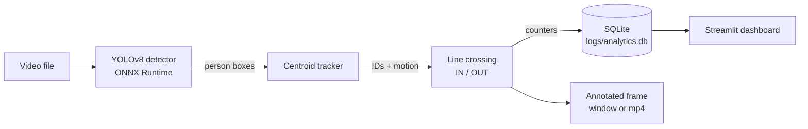

# Architecture

Smart-Counter is two processes that communicate only through a SQLite file.

## C++ pipeline (`src/`, `include/`)

| Component | Files | Responsibility |
| --- | --- | --- |
| Detector | `detector.cpp`, `detector.h` | Loads the ONNX model with ONNX Runtime (CUDA provider if available, CPU fallback). Resizes the frame to the model input (no letterboxing), decodes the YOLOv8 `[1, 84, 8400]` output, confidence threshold 0.5, NMS IoU 0.45. |
| Tracker | `tracker.cpp`, `tracker.h` | `SimpleTracker`: centroid tracker for COCO class 0 (person) only. See "Tracker" below. |
| Line counter | `line_counter.cpp`, `line_counter.h` | `LineCounter`: horizontal line at half of the frame height, counts IN / OUT per track ID. See "Counting" below. |
| Database | `database.cpp`, `database.h` | Creates the `people_count` table and inserts counter snapshots. See [DATABASE.md](DATABASE.md). |
| Main loop | `main.cpp` | CLI parsing, video I/O, drawing, FPS overlay, glue between the components above. |

`detection.h`, `tracker.h` and `line_counter.h` only depend on OpenCV core types. The `smartcounter_core` CMake target (tracker + line counter) is therefore built and unit-tested without ONNX Runtime, SQLite or a GPU (see [../tests/](../tests/)).

## Tracker

For each frame, detections of class 0 are reduced to box centres. Each centre is matched greedily to the nearest existing track centre closer than `distance_threshold` (default 50 px); otherwise a new track with a new ID is created. Unmatched tracks age by one frame and are deleted once they have been missed for more than `max_frames_missing` frames (default 5). Tracks missed for two or more frames are kept internally but not returned (to avoid drawing ghosts). IDs are never reused.

Known weaknesses of this approach (no motion model, no appearance features, no one-to-one assignment: two detections can claim the same track) are listed in the README.

## Counting

`LineCounter::update` compares `previous_center.y` and `center.y` of each track with the line `y`:

- previous above the line and current on/below it: **IN** (downward)
- previous below the line and current on/above it: **OUT** (upward)

Each track ID is counted at most once, in whichever direction it crosses first. IDs are not re-armed, so a person who crosses, turns around and crosses back is counted once.

The line is fixed at half the frame height. There is no GUI for placing it (see Roadmap in the README).

## Occupancy and drift

`INSIDE = IN - OUT`. Because the tracker can miss or duplicate crossings, this number can drift and even become negative. The overlay and the dashboard clamp the displayed value to 0 and show a warning that includes the raw (negative) value. This is a display safeguard, not a correction of the counts.

## Persistence

`main.cpp` writes a row `(in_count, out_count)` only when `IN + OUT` increases. The dashboard (`dashboard/app.py`) polls the same SQLite file.
